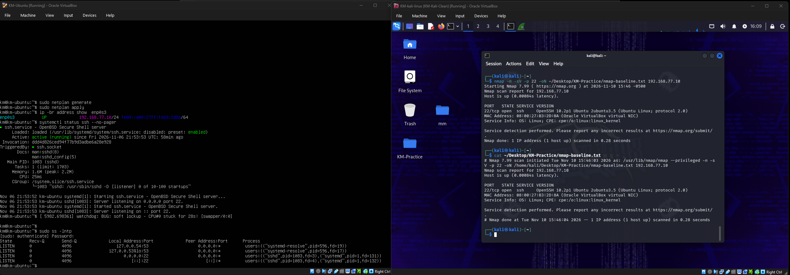
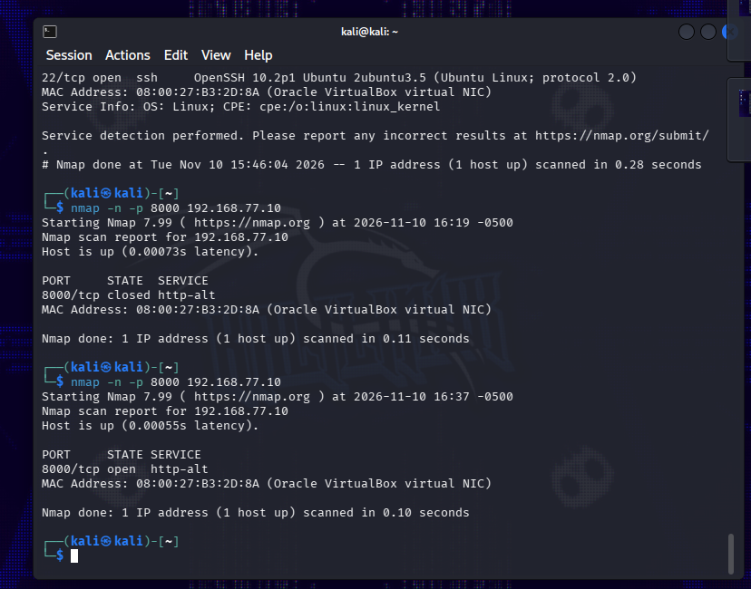
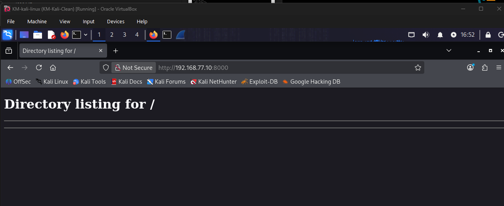
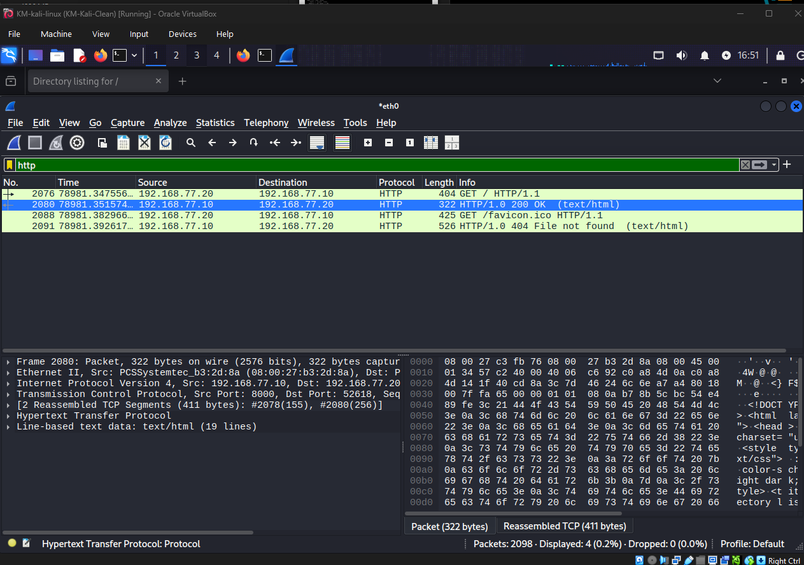
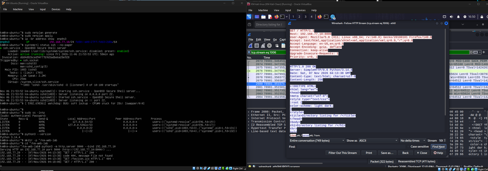

# KM Network Lab

A hands-on cybersecurity learning lab focused on Linux, network discovery, and traffic analysis.

## Lab Environment

| Machine | Role | IPv4 Address |
|---|---|---|
| Kali Linux | Scanning and packet analysis | 192.168.77.20 |
| Ubuntu Server | Lab target and SSH server | 192.168.77.10 |

Both virtual machines use the VirtualBox Internal Network named `KM-LAB`. All scans target my own lab systems.

## Exercise 1: SSH Service Discovery

### Objective

Discover a service from Kali, inspect its network traffic, and compare the results with listening sockets on Ubuntu.

### Commands Used

From Kali:

```bash
# Check connectivity
ping -c 4 192.168.77.10

# Scan selected TCP ports
nmap -n -p 22,80,443 192.168.77.10

# Scan the default 1,000 TCP ports
nmap -n 192.168.77.10

# Identify the SSH service and save a text report
nmap -n -sV -p 22 -oN ~/Desktop/KM-Practice/nmap-baseline.txt 192.168.77.10
```

From Ubuntu:

```bash
# Inspect listening TCP sockets and their processes
sudo ss -lntp
```

### Findings

- Ubuntu responded to all four ping requests.
- TCP port `22` was open; ports `80` and `443` were closed.
- The default scan found port `22` open and the other 999 scanned TCP ports closed.
- Service detection reported `OpenSSH 10.2p1 Ubuntu 2ubuntu3.5`.
- Ubuntu's socket listing confirmed SSH listening on `0.0.0.0:22` and `[::]:22`.
- Local DNS listeners used loopback addresses and were not exposed to Kali.

### Packet Analysis

I captured the selected-port scan on Kali's `eth0` interface using Wireshark.

The capture showed:

- ARP requests and replies resolving local IP addresses to MAC addresses.
- TCP SYN probes sent to ports `22`, `80`, and `443`.
- A SYN/ACK response from port `22`, indicating an open port.
- RST/ACK responses from ports `80` and `443`, indicating closed ports.
- A reset from Kali after the open-port response, ending the probe without completing the TCP handshake.

### Lessons Learned

- An open port indicates an available service, not proof of a vulnerability.
- A service's listening address affects whether other machines can reach it.
- Nmap shows what is reachable from the scanning machine; `ss` shows local listening sockets.
- Scanning 1,000 TCP ports does not cover every TCP port or any UDP ports.
- Service banners require further validation before making vulnerability claims.

## Evidence

### Nmap SSH Baseline

The screenshot below shows the saved scan report identifying OpenSSH on TCP port 22.



## Exercise 2: HTTP Service Lifecycle and Traffic Analysis

### Objective

Observe how starting and stopping a service changes a TCP port's state, then inspect an HTTP request and response in Wireshark.

### Procedure

1. Scanned TCP port `8000` on Ubuntu from Kali; it was **closed**.
2. Created a dedicated directory on Ubuntu and started a temporary HTTP server:

```bash
mkdir -p ~/km-web-lab
cd ~/km-web-lab
python3 -m http.server 8000 --bind 192.168.77.10
```

3. Repeated the scan from Kali; port `8000` was now **open**:

```bash
nmap -n -p 8000 192.168.77.10
```

4. Captured traffic on Kali's `eth0` interface and visited:

```text
http://192.168.77.10:8000
```

5. Applied the Wireshark display filter `http` and inspected the HTTP stream.
6. Saved the capture locally as `km-http-lab.pcapng`.
7. Stopped the server with `Ctrl+C` and repeated the scan; port `8000` returned to **closed**.

### Findings

- Starting the HTTP server changed port `8000` from closed to open.
- The browser completed a TCP handshake before sending its HTTP request.
- `GET /` received a `200 OK` response containing an empty directory listing.
- The browser also requested `/favicon.ico`, which received `404 File not found` because no icon file existed.
- The HTTP stream exposed readable request headers, response headers, and HTML content.
- The server header reported `SimpleHTTP/0.6 Python/3.14.4`.
- Ubuntu's server log recorded the client's lab IP address, requests, and response codes.
- Stopping the server closed the port again.

### Evidence

#### Port State Before and After Starting the Server



#### HTTP Directory Listing



#### HTTP Requests and Responses



#### HTTP Stream and Server Log



### Lessons Learned

- A listening service makes a port available; a port number alone does not.
- TCP establishes the connection, while HTTP carries the web request and response.
- An HTTP `404` response can indicate a missing resource rather than a failed connection.
- Plain HTTP does not encrypt application content.
- Packet captures and server logs provide complementary evidence.
- Identifying a server version does not by itself establish a vulnerability.

The packet capture is stored locally and has not been uploaded to this repository.

## Exercise 3: SSH Authentication Log Analysis

### Objective

Generate controlled SSH authentication events and correlate client-side results with Ubuntu server logs.

### Procedure

1. Verified that `ssh.socket` was enabled.
2. Established a successful SSH connection from Kali to Ubuntu, then ended it with `exit`.
3. Reviewed the server logs for successful authentication and session closure.
4. Monitored new SSH messages:

```bash
sudo journalctl -f -n 0 -t sshd -t sshd-session
```

5. From Kali, attempted one password-based login using an intentionally incorrect password:

```bash
ssh -o PreferredAuthentications=password -o PubkeyAuthentication=no -o NumberOfPasswordPrompts=1 km@192.168.77.10
```

6. Stopped log monitoring with `Ctrl+C` and exported the failed attempt's process logs:

```bash
sudo journalctl -b _PID=1988 --no-pager > ~/ssh-failed-login.txt
cat ~/ssh-failed-login.txt
```

The PID `1988` belongs to this specific lab attempt. Process IDs change and must be identified again when repeating the exercise.

### Findings

The successful login produced `Accepted password` and `session opened` messages. A later process-based query also revealed `session closed for user km`.

The controlled failed attempt produced:

- `authentication failure`
- `Failed password for km from 192.168.77.20 port 34026 ssh2`
- `Connection closed by authenticating user km ... [preauth]`

Kali displayed `Permission denied`, matching the authentication failure recorded on Ubuntu.

The source port `34026` was a temporary client port; the SSH server listened on TCP port `22`.

### Investigation Notes

- The live query filtered by `ssh.service` did not display the successful session's closure message.
- Querying the session process's PID revealed the closure event.
- A PID-only search can include unrelated events because process IDs are reused. Filtering by the current boot reduces this ambiguity.
- One login attempt can produce multiple log messages.
- This was one intentional failed login in an isolated lab, not evidence of a brute-force attack.

### Evidence

#### Ubuntu Authentication Logs


#### Kali Client Result


### Lessons Learned

- Correlate client output with server logs.
- Check the account, source address, timestamp, and authentication outcome.
- Missing results from one log filter do not prove that an event was not recorded.

The exported text log remains stored locally on Ubuntu.
  
## Scope

This repository documents beginner lab exercises. It does not claim a complete vulnerability assessment.
